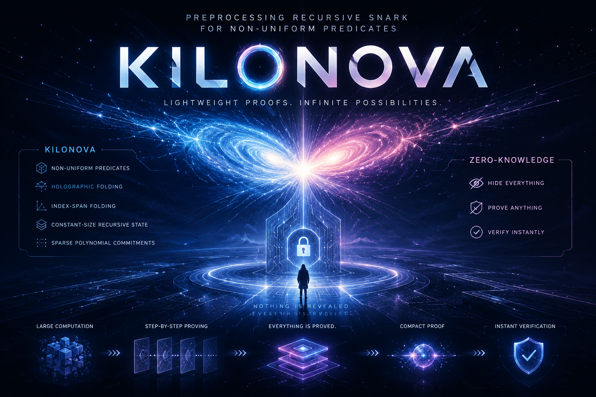

# KiloNova

This is a proof-of-concept implementation of KiloNova for academic use.
Please do NOT use this in the production environment.

# Introduction

KILONOVA is a preprocessing recursive SNARK for fixed sets of non-uniform predicates. By introducing holographic folding schemes and index-span folding, it enables efficient multi-predicate PCD with constant-size recursive states. This repository contains the proof-of-concept implementation of KILONOVA and its core cryptographic components for scalable recursive proofs. **The PoC does not provide zero knowledge** (see `docs/protocol-spec.md` §4).

<div align="center">
  
</div>

# Development Progress

Status as of 2026-11-14 (P6). Details are in `PLAN.md`, `docs/baseline-status.md`, `docs/P3-report.md`, `docs/P5-report.md`, `docs/P4-report.md` and `docs/P6-report.md`.

## Holographic Folding Schemes

1. Multi-folding for CCS instances: algebraic PoC in `folding/` (reference only). ✅
2. Non-uniform (indexed) folding, Direct and Span variants. v1 (`Nova/src/kilonova/nifs.rs`, R1CS only, used by the recursion layer) still folds over the wrong field (B15). **v2 (`Nova/src/kilonova/hfs/`, P3) folds over the native field, for any CCS template and μ running + ν incoming inputs, with transcript v2.** ✅ natively (no recursion yet): 100-step alternating R1CS and degree-5 chains are accepted by the verifier, the decider and the kn-ccs oracle on every step.
3. Index commitment folding. ✅

## Preprocessing Recursive SNARK

1. Succinct in-circuit HFS verifier; setup converges (2 iterations for K=3). ✅
2. Index-span folding (Span variant). ✅ P4: authenticated `PredicateFamily` (stable ids, canonical kn-ccs matrix encoding, family digest bound in every transcript and link hash, `Nova/src/kilonova/family/`); explicit folded-matrix and weighted-evaluation paths cross-checked for K = 1, 2, 4, 16; support growth and memory vs K measured (`results/raw/p4-family.jsonl`).
3. Multi-step non-uniform IVC. ✅ on HFS v2 with CycleFold (`Nova/src/kilonova/ivc/`, P5, D1 = (a)): K = 2/4, T = 1/16/64 chains verify, Direct and Span; rejections tested. P4: the schedule is enforced in-circuit by the program's selection function φ (`ivc::program`), and `verify(pp, n, z0)` takes no schedule; it returns the trace hash recovered from the proof (G3, G4 closed). The v1 recursion path (`kilonova::RecursiveSNARK`) is kept unchanged as historical evidence and remains B15-broken.
4. Multi-predecessor PCD (trees). ✅ P6 (`Nova/src/kilonova/pcd/`): leaf, merge and dummy circuits in one non-uniform family; each merge verifies one HFS v2 fold of μ = a running + ν = a incoming instances in-circuit and folds the a CycleFold accumulators; positions, ranges, predecessor order, task id and leaf ids bound (tree hash + in-circuit ranges); `verify_root` needs only the proof and returns the root statement. 64-leaf W4 trees verify with the same result for a = 2, 4 (Direct) and 8 (Span; Direct a = 8 exceeds the setup cap); duplicate, missing, spliced, reordered and forged predecessors rejected (`results/raw/p6-tree.jsonl`).
5. Compressed SNARK / independent final verifier. ⏳ (P7)
6. Native high-degree CCS: builder and reference checker in `ccs/` (P2) ✅; native folding over CCS (HFS v2, P3) ✅; recursion with a native degree-5 application row (template R1CS + power rows) ✅ (P5)

## Build & test

```bash
cargo test -p nova-snark --release --lib kilonova -- --test-threads=1
```

## Experiment harness (P1)

`tools/kn-run` runs one named scenario or one test in a fresh process and appends one JSON record per run to `results/raw/<experiment>.jsonl`. The record layout is `results/schema.json` (PLAN.md §8), and the plan and acceptance report are `docs/P1-plan.md` and `docs/P1-report.md`.

```bash
cargo build -p kn-run --release
target/release/kn-run selfcheck                       # P1 acceptance checks (~30 min; --quick skips proving)
target/release/kn-run scenario constraints variant=direct --experiment demo
target/release/kn-run scenario bootstrap variant=span --seed 202
target/release/kn-run test kilonova::tests::test_setup_fixed_point_converges
```

P6 tree PCD: `target/release/kn-run scenario tree a=2 L=64 variant=direct --seed 101 --experiment p6-tree` (main, single-threaded); `mode=levels parallel=1 --threads 4 --experiment p6-tree-parallel` measures parallel latency separately.

Scenarios: `noop`, `sleep ms=N`, `alloc bytes=N`, `fail` (harness calibration), plus `constraints`, `bootstrap` and `chain steps=T` with `variant=direct|span` on the K=3 example family. `chain` with T ≥ 2 currently fails on B15, and that failure is recorded.

Conventions:

- Every run gets a record with a status: `success`, `failure`, `timeout` (killed by `--timeout-s`, default 1800) or `oom`. A field that does not apply is `null` with an entry in `null_reasons`; it is never 0.
- `wall_ms` and `peak_rss_bytes` are measured by the runner (spawn to reap, `wait4` `ru_maxrss`), so `wall_ms` includes process start-up. On macOS the first exec of a freshly built binary takes about 0.6–1 s, so discard or warm up the first run. `setup_ms`, `recursive_ms` (`RecursiveSNARK::new` plus all `prove_step` calls) and `verify_warm_ms` are in-process timers around exactly that call. `witness_ms` is null because witness generation is inside `recursive_ms`.
- `threads` is the child's actual rayon thread count. `--threads` sets `RAYON_NUM_THREADS` (default 1, the PLAN.md §5.1 main setting).
- `input_digest` and `result_digest` hash the semantic inputs and outputs (seeded z0 and trace; pp digest, shape sizes, outputs). Two runs of the same configuration must agree on both, and on `config_hash`.
- `--mem-cap-mb` is enforced with `RLIMIT_AS` on Linux only; records say `mem_cap_enforced`.
- Raw child stdout/stderr are kept in `results/raw/logs/<run_id>.{out,err}`. Records are append-only.
- Laptop numbers are development data only. Formal runs happen on the dedicated host (PLAN.md §5.2).

## CCS reference oracle (P2)

`ccs/` (crate `kn-ccs`) builds native CCS relations, including high-degree ones written with repeated multisets, and checks ACCS/CCCS instance–witness pairs. It is a slow, independent oracle for P3: generic over `ff::PrimeField`, with no dependency on `kilonova/`, and with the same conventions (`z = (w ‖ u ‖ io)`, little-endian MLE bits, Nova-style padding). Plan and report: `docs/P2-plan.md`, `docs/P2-report.md`.

```bash
cargo test -p kn-ccs --release
target/release/kn-run scenario ccs steps=1024 --seed 101     # fifth-power chain: native CCS vs R1CS
```

## Native-field HFS v2 (P3)

`Nova/src/kilonova/hfs/` is the native-field holographic folding scheme: it folds over `E::Scalar` (fixing B15 for native folding), is generic over the CCS template (t, q, d) and over μ running and ν incoming inputs, and has Direct (committed λ) and Span (public λ) variants. Its transcript is v2 (Poseidon over `E::Scalar`, commitments as 4 × 64-bit limbs; `docs/protocol-spec.md` §8). There is no recursion yet, and the v1 recursion path is unchanged. Plan and report: `docs/P3-plan.md`, `docs/P3-report.md`.

```bash
cargo test -p nova-snark --release --lib kilonova::hfs -- --test-threads=1
target/release/kn-run scenario hfs template=power5 variant=direct steps=100 --seed 101 --experiment p3-hfs
```
